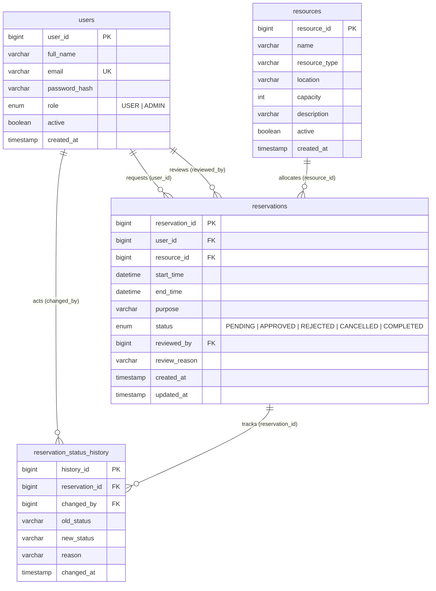

<div align="center">

# ⚡ SlotSync

**Intelligent Resource Booking & Facility Reservation Management System**

[](https://openjdk.org/)
[-FF7800?style=for-the-badge&logo=jakartaee&logoColor=white)](https://jakarta.ee/)
[](https://www.mysql.com/)
[](https://tomcat.apache.org/)
[](https://en.wikipedia.org/wiki/Model%E2%80%93view%E2%80%93controller)

<p align="center">
  A high-performance, enterprise-grade Java web application designed for campus facilities, research laboratories, conference rooms, smart hardware, and computing systems—featuring <b>zero double-booking guarantees via pessimistic database locking</b>, multi-threaded concurrency controls, full audit logging, role-based access security, and an analytics dashboard.
</p>

[Key Features](#-key-features) •
[Architecture](#-system-architecture) •
[Database Schema](#-database-schema--design) •
[Installation & Setup](#-getting-started) •
[Test Suite](#-automated-testing--verification) •
[Route Reference](#-endpoint--route-reference)

---

</div>

## 📌 Overview

**SlotSync** solves resource contention, overlapping schedule conflicts, and facility management overhead in academic institutions, enterprises, and research facilities.

Built with a clean **Jakarta EE MVC + DAO** architectural pattern, it eliminates common scheduling flaws (race conditions, ghost bookings, and concurrent collision) by combining database-level ACID transactions, pessimistic row-level locking (`SELECT ... FOR UPDATE`), and cryptographic CSRF/session security.

---

## ✨ Key Features

### 🛡️ Concurrency & Double-Booking Protection
- **Pessimistic Row Locking (`SELECT ... FOR UPDATE`)**: Synchronizes concurrent booking requests at the database engine level, preventing race conditions.
- **Strict Interval Overlap Detection**: Uses the mathematical overlap formula:
  $$\text{Overlap} \iff (\text{Existing.StartTime} < \text{Requested.EndTime}) \land (\text{Existing.EndTime} > \text{Requested.StartTime})$$
- **Back-to-Back Scheduling**: Allows precise back-to-back reservations (e.g., Slot 1: `10:00–12:00` and Slot 2: `12:00–14:00` for the same facility).
- **Transactional Rollback**: Ensures partial failures automatically revert database state cleanly without orphaned records.

### 👥 Role-Based Access Control (RBAC) & User Management
- **Two User Roles**: `USER` (Students, Faculty, Staff) and `ADMIN` (Facility & IT Administrators).
- **Authentication & Authorization Filters**:
  - `AuthFilter`: Protects all authenticated routes and remembers target URLs for post-login redirection.
  - `AdminFilter`: Restricts `/admin/*` operations exclusively to users possessing administrative credentials.
- **Multi-Iteration Salted Password Hashing**: Passwords secured via **SHA-512 + 65,536 iterations with 128-bit random salts** (Modular Crypt format) and timing-safe comparison to prevent side-channel timing attacks.

### 🏢 Comprehensive Resource Inventory
- Manage physical rooms, labs, and hardware devices:
  - **Computer Laboratories** (e.g., Advanced Computing Lab, AI & Robotics Lab)
  - **Meeting Rooms & Boardrooms** (e.g., Executive Boardroom, Study Pods)
  - **Conference Halls** (e.g., Faculty Conference Hall)
  - **Portable & High-End Hardware** (e.g., 4K Laser Projectors, High-Performance Workstations)
- Filter catalog by resource type, location, capacity, and active availability.

### 🔄 End-to-End Reservation Lifecycle & Audit Trail
- **State Machine**:
  ```mermaid
  stateDiagram-v2
      [*] --> PENDING: User Submits Request
      PENDING --> APPROVED: Admin Approves
      PENDING --> REJECTED: Admin Rejects (Reason Required)
      PENDING --> CANCELLED: User / Admin Cancels
      APPROVED --> COMPLETED: Slot Time Concluded
      APPROVED --> CANCELLED: User / Admin Cancels
      REJECTED --> [*]
      CANCELLED --> [*]
      COMPLETED --> [*]
  ```
- **Historical Audit Trail**: Every status transition logs `changed_by` user ID, previous status, updated status, timestamp, and review reason into the `reservation_status_history` table.

### 📊 Administrative Analytics & Insights
- Real-time utilization rates per resource.
- Total reservation status distribution (Approved vs. Pending vs. Rejected vs. Cancelled).
- Summary KPI metric counters for active resources, registered users, and active booking queues.

### 🎨 Modern Dark Glassmorphism UI
- Responsive layout crafted with custom CSS variables, glassmorphism cards, micro-interactions, custom badges, and accessible SVG icons.
- Built without bulky runtime JS frameworks for maximum rendering speed and low memory footprint.

---

## 🏗️ System Architecture

SlotSync adheres to strict separation of concerns through the **MVC + DAO + Service Layer** pattern:

```
                          ┌────────────────────────┐
                          │   Browser Client (UI)  │
                          │   JSP + CSS + JS (DOM) │
                          └───────────┬────────────┘
                                      │ HTTP / HTTPS
                                      ▼
             ┌──────────────────────────────────────────────────┐
             │            Servlet Filter Pipeline               │
             │  ┌──────────────┐ ┌──────────────┐ ┌───────────┐ │
             │  │  CsrfFilter  │ │  AuthFilter  │ │AdminFilter│ │
             │  └──────────────┘ └──────────────┘ └───────────┘ │
             └────────────────────────┬─────────────────────────┘
                                      │
                                      ▼
             ┌──────────────────────────────────────────────────┐
             │                Controller Layer                  │
             │           (Jakarta WebServlets)                  │
             │  • LoginServlet           • ResourceListServlet  │
             │  • DashboardServlet       • ReservationCreate... │
             │  • AdminResourceServlet   • AdminReportServlet   │
             └────────────────────────┬─────────────────────────┘
                                      │
                                      ▼
             ┌──────────────────────────────────────────────────┐
             │                 Service Layer                    │
             │           (Business Logic & Rules)               │
             │  • UserService            • ResourceService      │
             │  • ReservationService     • AdminReportService   │
             └────────────────────────┬─────────────────────────┘
                                      │
                                      ▼
             ┌──────────────────────────────────────────────────┐
             │            Data Access Object (DAO)              │
             │  • UserDAO                • ResourceDAO          │
             │  • ReservationDAO         • HistoryDAO           │
             └────────────────────────┬─────────────────────────┘
                                      │ JDBC / PreparedStatements
                                      ▼
                          ┌────────────────────────┐
                          │  MySQL 8.0+ Database   │
                          │  (ACID + Row Locks)    │
                          └────────────────────────┘
```

---

## 🗄️ Database Schema & Design

The database schema is defined in [database/schema.sql](file:///d:/EclipseWorkSpace/SlotSync/database/schema.sql).



---

## 📂 Project Structure

```
SlotSync/
├── database/
│   ├── schema.sql                         # Complete DDL tables, indexes & foreign keys
│   └── sample-data.sql                    # Initial seed data for users, resources & bookings
├── src/
│   └── main/
│       ├── java/
│       │   ├── db.properties              # MySQL JDBC connection configuration
│       │   └── com/slotsync/
│       │       ├── controller/            # Jakarta Servlets (HTTP request routing)
│       │       │   ├── AdminReportServlet.java
│       │       │   ├── AdminReservationServlet.java
│       │       │   ├── AdminResourceServlet.java
│       │       │   ├── DashboardServlet.java
│       │       │   ├── LoginServlet.java
│       │       │   ├── LogoutServlet.java
│       │       │   ├── MyReservationsServlet.java
│       │       │   ├── RegisterServlet.java
│       │       │   ├── ReservationCancelServlet.java
│       │       │   ├── ReservationCreateServlet.java
│       │       │   ├── ReservationReviewServlet.java
│       │       │   ├── ResourceDetailsServlet.java
│       │       │   └── ResourceListServlet.java
│       │       ├── dao/                   # Data Access Objects (Raw SQL + PreparedStatements)
│       │       │   ├── ReservationDAO.java
│       │       │   ├── ReservationStatusHistoryDAO.java
│       │       │   ├── ResourceDAO.java
│       │       │   └── UserDAO.java
│       │       ├── exception/             # Custom domain exceptions
│       │       │   ├── BookingConflictException.java
│       │       │   ├── InvalidReservationException.java
│       │       │   └── ResourceNotFoundException.java
│       │       ├── filter/                # Security and authentication filters
│       │       │   ├── AdminFilter.java
│       │       │   ├── AuthFilter.java
│       │       │   └── CsrfFilter.java
│       │       ├── model/                 # Domain entities / POJOs
│       │       │   ├── Reservation.java
│       │       │   ├── ReservationStatusHistory.java
│       │       │   ├── Resource.java
│       │       │   └── User.java
│       │       ├── service/               # Transactional business logic
│       │       │   ├── AdminReportService.java
│       │       │   ├── ReservationService.java
│       │       │   ├── ResourceService.java
│       │       │   └── UserService.java
│       │       ├── test/                  # Automated integration & concurrency suite
│       │       │   └── SlotSyncIntegrationTest.java
│       │       └── util/                  # Helper utilities (DB connection, Hashing, Validation)
│       │           ├── DBConnection.java
│       │           ├── PasswordUtil.java
│       │           └── ValidationUtil.java
│       └── webapp/
│           ├── assets/
│           │   ├── css/style.css          # Design system & dark theme stylesheets
│           │   └── js/app.js              # Client-side dynamic interaction script
│           ├── WEB-INF/
│           │   ├── lib/                   # Jakarta Servlet API & MySQL Connector JARs
│           │   ├── views/                 # JSP View templates
│           │   │   ├── admin/             # Admin dashboard, resource forms, reviews, reports
│           │   │   ├── auth/              # Login & registration views
│           │   │   ├── common/            # Header, footer, flash alerts
│           │   │   ├── error/             # 403, 404, 500 error pages
│           │   │   ├── resources/         # Resource catalog & booking modal
│           │   │   └── user/              # User dashboard & personal reservations
│           │   └── web.xml                # Deployment descriptor & error routing
│           └── index.jsp                  # Landing page
└── README.md
```

---

## 🚀 Getting Started

### 📋 Prerequisites
- **JDK 17** or **JDK 21+** (Java 25 compatible)
- **Apache Tomcat 10.1+** (Supports Jakarta Servlet Specification 6.0)
- **MySQL 8.0+** or **MariaDB**
- **Eclipse IDE for Enterprise Java and Web Developers** (or IntelliJ IDEA Ultimate / VS Code)

---

### ⚙️ Step 1: Database Setup

1. Open MySQL CLI or MySQL Workbench.
2. Execute the schema script:
   ```sql
   SOURCE d:/EclipseWorkSpace/SlotSync/database/schema.sql;
   ```
3. Load the sample seed data:
   ```sql
   SOURCE d:/EclipseWorkSpace/SlotSync/database/sample-data.sql;
   ```

---

### 🔑 Step 2: Configure Database Credentials

Open [src/main/java/db.properties](file:///d:/EclipseWorkSpace/SlotSync/src/main/java/db.properties) and configure your MySQL connection details:

```properties
db.driver=com.mysql.cj.jdbc.Driver
db.url=jdbc:mysql://localhost:3306/slotsync?useSSL=false&allowPublicKeyRetrieval=true&serverTimezone=UTC&characterEncoding=UTF-8
db.username=YOUR_MYSQL_USERNAME
db.password=YOUR_MYSQL_PASSWORD
```

---

### 💻 Step 3: Run in Eclipse / Tomcat

1. Launch **Eclipse IDE**.
2. Go to **File → Import → General → Existing Projects into Workspace**.
3. Browse and select the `SlotSync` root directory.
4. Right-click on `SlotSync` → **Run As → Run on Server**.
5. Select **Apache Tomcat v10.1** (configured with Jakarta EE 10).
6. Open your browser and navigate to:
   ```
   http://localhost:8080/SlotSync/
   ```

---

## 🔐 Default Demo Accounts

The seed database comes with the following pre-configured user credentials:

| Role | Name | Email | Password | Access Privileges |
| :--- | :--- | :--- | :--- | :--- |
| **ADMIN** | System Administrator | `admin@slotsync.com` | `Admin@12345` | Full administrative control, resource CRUD, approvals/rejections, reports |
| **USER** | Dr. John Doe | `john.doe@slotsync.com` | `User@12345` | Resource catalog, submit reservations, cancel own bookings, dashboard |
| **USER** | Prof. Jane Smith | `jane.smith@slotsync.com` | `User@12345` | Submit reservations, schedule meetings, track status |
| **USER** | Alex Turner | `alex.turner@slotsync.com` | `User@12345` | Student / researcher booking access |

---

## 🧪 Automated Testing & Verification

SlotSync includes an end-to-end integration and multi-threaded concurrency verification suite located at [src/main/java/com/slotsync/test/SlotSyncIntegrationTest.java](file:///d:/EclipseWorkSpace/SlotSync/src/main/java/com/slotsync/test/SlotSyncIntegrationTest.java).

### Test Coverage
- **Test 1**: MySQL JDBC connection verification.
- **Test 2**: User authentication, password verification, duplicate email rejection.
- **Test 3**: Resource inventory catalog CRUD and filtering.
- **Test 4**: Double-booking conflict validation (overlap boundary tests, back-to-back allowance).
- **Test 5**: **Multi-threaded Concurrency Test** (`ExecutorService` + `CountDownLatch` firing 4 simultaneous conflicting requests — validates that exactly 1 succeeds and 3 are safely rejected).
- **Test 6**: Status lifecycle transitions (Approval, Audit History logging, Slot freeing on cancellation).
- **Test 7**: Admin reports and utilization analytics generation.

### Running the Test Suite
Run the class directly in Eclipse:
> Right-click `SlotSyncIntegrationTest.java` → **Run As → Java Application**

Output:
```text
=================================================================
           SLOTSYNC AUTOMATED INTEGRATION TEST SUITE            
=================================================================
[TEST 1] Testing MySQL JDBC connection... PASSED (Database: slotsync)
[TEST 2] Testing User authentication & registration... PASSED (Auth, Multi-Iteration Hash, Duplicate email protection verified)
[TEST 3] Testing Resource inventory & availability filtering... PASSED (CRUD & Filtering verified)
[TEST 4] Testing Double-Booking Conflict Prevention (Pessimistic Locking)... PASSED (Overlaps rejected, Back-to-back allowed)
[TEST 5] Testing Simultaneous Multi-Threaded Concurrent Booking Requests... PASSED (Exactly 1 succeeded, 3 safely rejected)
[TEST 6] Testing Admin Approval, Rejection with Reason, and User Cancellation... PASSED (Approval, History auditing, Slot freeing on cancel)
[TEST 7] Testing Administrator Reports and Analytics... PASSED (Metrics, breakdown & utilization generated)
=================================================================
TEST RESULTS: 7 Passed, 0 Failed
=================================================================
```

---

## 🌐 Endpoint & Route Reference

### Public Routes
| Route | Method | Description |
| :--- | :--- | :--- |
| `/` | `GET` | Landing page (redirects to `/dashboard` if logged in) |
| `/login` | `GET`, `POST` | User authentication & session initiation |
| `/register` | `GET`, `POST` | New user account registration |
| `/resources` | `GET` | Public resource catalog with keyword & type filters |
| `/resources/details` | `GET` | Detailed resource view and schedule availability |

### User Routes (Requires Authentication)
| Route | Method | Description |
| :--- | :--- | :--- |
| `/dashboard` | `GET` | User overview dashboard with recent reservations and status metrics |
| `/reservations/new` | `GET`, `POST` | Submit a new reservation request with conflict check |
| `/my-reservations` | `GET` | View personal booking history with status filter |
| `/reservations/cancel` | `POST` | Cancel a pending or approved reservation |
| `/logout` | `GET`, `POST` | Invalidate HTTP session and log out |

### Admin Routes (Requires `ADMIN` Role)
| Route | Method | Description |
| :--- | :--- | :--- |
| `/admin/dashboard` | `GET` | Administrative control panel with system KPIs |
| `/admin/resources` | `GET` | Full resource management table (Active & Inactive) |
| `/admin/resources/create` | `GET`, `POST` | Add a new facility or equipment to inventory |
| `/admin/resources/edit` | `GET`, `POST` | Modify resource details or change active status |
| `/admin/resources/delete` | `POST` | Toggle resource active / deactivated state |
| `/admin/reservations` | `GET` | Review queue for all reservations across users |
| `/admin/reservations/review` | `POST` | Approve or reject a booking (with mandatory rejection reason) |
| `/admin/reports` | `GET` | Utilization analytics, status breakdown charts & reports |

---

## 🔒 Security Best Practices Implemented

1. **Cross-Site Request Forgery (CSRF) Defense**: Cryptographic token generation via `SecureRandom`, stored in user session and validated on all mutating `POST` requests.
2. **SQL Injection Immunization**: 100% of database interactions utilize parameterized `PreparedStatement` queries.
3. **Cross-Site Scripting (XSS) Sanitization**: JSP expressions use JSTL `<c:out>` and manual escaping utility for user-supplied strings.
4. **Session Security**: Session cookies configured with `HttpOnly=true` and a 30-minute timeout to mitigate cookie theft.
5. **Ownership & Privilege Verification**: Users can only cancel their own reservations; administrator actions enforce strict role validation via `AdminFilter`.

---

## 📄 License

This project is developed for academic, enterprise, and institutional resource management. You are free to customize and extend it for your organization's specific requirements.
